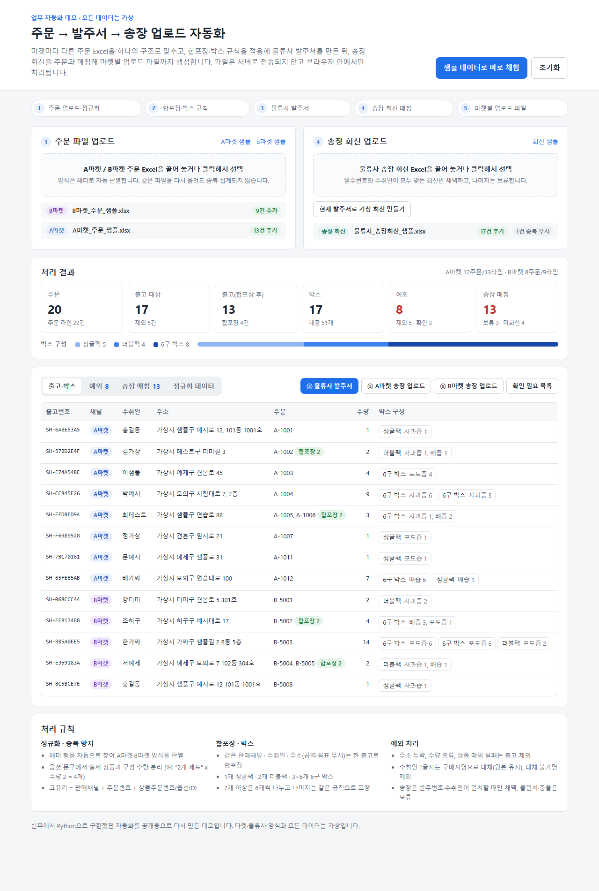
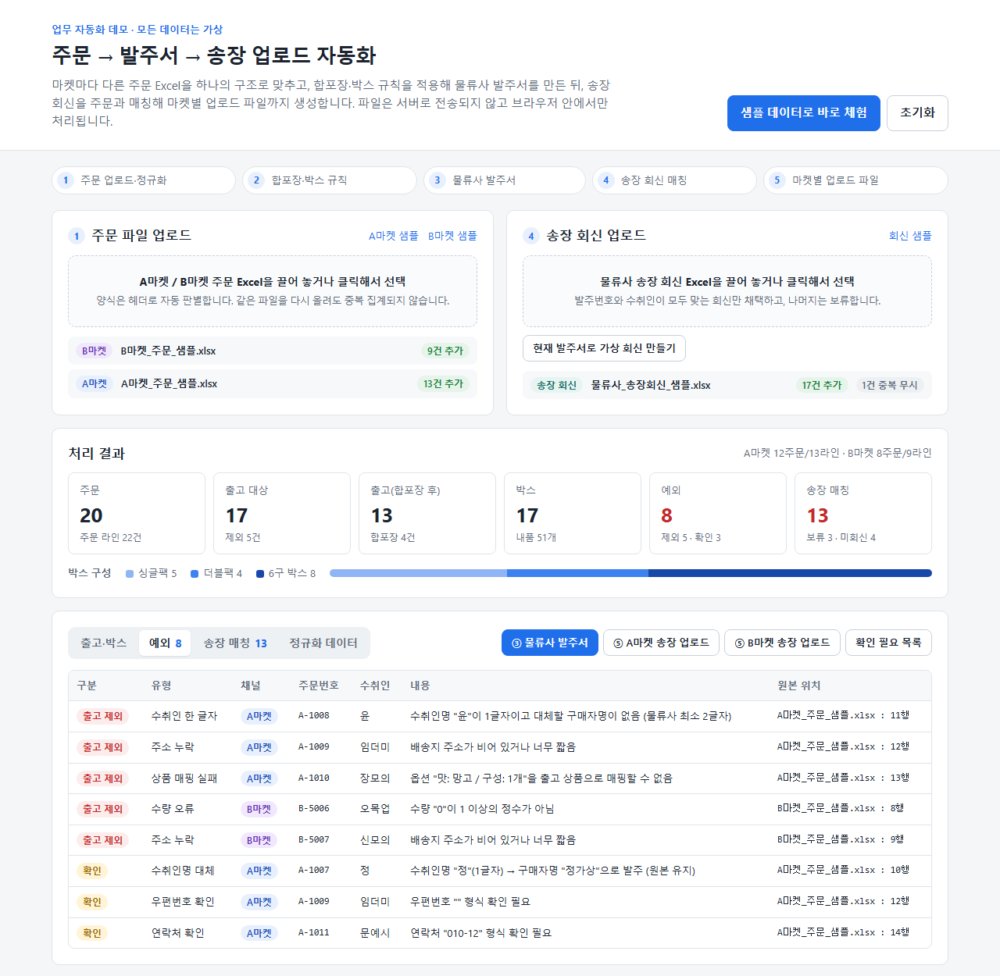
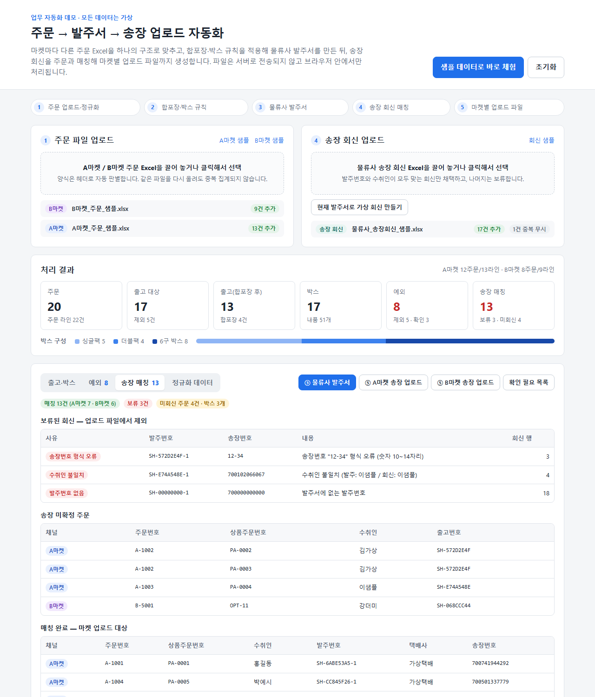
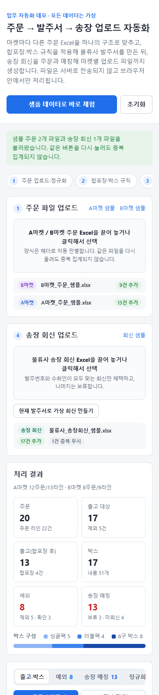

# 주문 → 발주서 → 송장 업로드 자동화 (데모)

쇼핑몰 주문 Excel을 물류사 발주서로 바꾸고, 물류사가 보내 준 송장 회신을 다시 주문과 맞춰 마켓별 송장 업로드 파일을 만드는 과정을 브라우저 안에서 처리하는 정적 웹앱입니다.

> 실무에서는 Python으로 구현해 운영했던 주문·물류 자동화를, 고객사 코드와 데이터를 쓰지 않고 공개용으로 처음부터 다시 구현한 것입니다.
> 화면에 나오는 "A마켓", "B마켓", "가상택배" 양식과 모든 이름·주소·연락처는 가상입니다. 실제 회사 양식을 복제하지 않았습니다.



## 문제

판매자가 여러 마켓에서 주문을 받으면 출고 담당자는 매일 다음 작업을 Excel로 반복합니다.

1. 마켓마다 컬럼 이름·순서·주소 표기·옵션 문구가 다른 주문 파일을 받는다.
2. 같은 사람에게 가는 주문을 묶고(합포장), 수량에 맞는 박스를 정해 물류사 양식으로 옮겨 적는다.
3. 주소 누락, 한 글자 수취인처럼 물류사 시스템에서 튕기는 주문을 눈으로 찾아낸다.
4. 물류사가 송장번호를 회신하면, 어느 주문의 송장인지 맞춰서 마켓별 업로드 양식으로 다시 옮긴다.

이 과정은 손이 많이 가고, 같은 파일을 두 번 처리하거나 송장을 다른 주문에 붙이는 사고가 나기 쉽습니다.

## 해결 방식

| 단계 | 처리 내용 |
| --- | --- |
| 1. 정규화 | 시트 상단 10행에서 필수 헤더를 찾아 A마켓/B마켓 양식을 자동 판별하고, 공통 주문 라인 구조로 변환합니다. 옵션 문구에서 실제 상품과 구성 수량을 분리합니다(예: `맛: 포도 / 구성: 2개 세트` x 수량 2 = 포도즙 4개). B마켓처럼 주소와 상세주소가 나뉜 양식은 합칩니다. |
| 2. 중복 방지 | 고유키 `판매채널:주문번호:상품주문번호(옵션ID)`로 누적합니다. 같은 파일을 다시 올려도 "0건 추가 · N건 중복 무시"로 처리됩니다. |
| 3. 검증 | 주소 누락, 수량 오류, 상품 매핑 실패, 대체 불가능한 한 글자 수취인은 **출고 제외**합니다. 수취인이 한 글자이면 구매자명으로 발주하되 원본 값은 그대로 둡니다. 연락처·우편번호 형식 이상은 **확인 필요**로 표시하고 출고합니다. 모든 예외에 원본 파일명과 행 번호가 남습니다. |
| 4. 합포장 · 박스 | 같은 판매채널 · 수취인 · 주소(공백·쉼표 차이 무시)를 한 출고로 묶습니다. 1개 싱글팩, 2개 더블팩, 3~6개 6구 박스, 7개 이상은 6개씩 나누고 나머지에 같은 규칙을 적용합니다(예: 14개 → 6구 + 6구 + 더블팩). 어떤 주문 라인이 어느 박스에 들어갔는지 추적합니다. |
| 5. 발주서 | 박스 1개당 1행의 물류사 발주서(+예외 시트)를 Excel로 내보냅니다. 발주번호는 출고 키의 해시라서 업로드 순서와 관계없이 같은 값이 나옵니다. |
| 6. 송장 매칭 | 회신의 발주번호가 발주서에 있고 수취인도 일치할 때만 채택합니다. 송장번호 형식 오류, 수취인 불일치, 없는 발주번호, 같은 발주번호에 다른 송장(충돌), 한 송장을 여러 발주번호에 사용한 경우는 **보류**합니다. 여러 박스로 나뉜 주문은 그 라인이 담긴 첫 박스의 송장으로 올립니다. |
| 7. 업로드 파일 | 매칭된 주문만 A마켓 / B마켓 각각의 업로드 양식으로 나눠 내보냅니다. 보류·미회신·주문 예외는 "확인 필요 목록" Excel로 따로 받습니다. |

### 예외 · 매칭 화면

| 예외 목록 | 송장 매칭 |
| --- | --- |
|  |  |



## 체험하기

1. 화면 오른쪽 위 **샘플 데이터로 바로 체험**을 누르면 A마켓·B마켓 주문과 송장 회신 샘플이 한 번에 들어옵니다.
2. 다시 눌러도 숫자가 늘지 않는 것(중복 무시)을 확인할 수 있습니다.
3. **물류사 발주서**, **A마켓/B마켓 송장 업로드**, **확인 필요 목록** 버튼으로 결과 Excel을 받습니다.
4. 직접 해 보려면 `samples/` 폴더의 파일을 끌어다 놓거나, 주문만 올린 뒤 **현재 발주서로 가상 회신 만들기**를 눌러 보세요.

샘플에는 다음 상황이 일부러 들어 있습니다: 같은 사람의 서로 다른 주문(합포장), 공백·쉼표만 다른 주소, 7개·9개·14개 주문(박스 분할), 한 글자 수취인(대체 가능/불가), 주소 누락, 수량 0, 매핑되지 않는 옵션, 잘못된 연락처, 회신 누락·오타·형식 오류·없는 발주번호·중복 행.

## 기술 선택 이유

- **빌드 없는 정적 웹앱 (HTML/CSS/JavaScript)**: 담당자가 설치 없이 브라우저로 열 수 있고, GitHub Pages에 그대로 올라갑니다. 주문 데이터가 서버로 나가지 않아 개인정보 부담이 없습니다.
- **SheetJS (cdnjs 0.18.5 고정)**: 브라우저에서 .xlsx 읽기·쓰기를 모두 처리합니다. 버전을 고정해 CDN 갱신으로 동작이 바뀌지 않게 했습니다.
- **핵심 로직을 순수 함수 모듈로 분리 (`js/core.js`)**: DOM·파일·SheetJS에 의존하지 않고 "행 배열 → 행 배열"로만 동작합니다. 같은 파일을 브라우저에서는 `<script>`로, Node에서는 `require`로 불러 테스트합니다. 화면(`js/app.js`)은 파일 읽기와 렌더링만 담당합니다.
- **원본 불변 · 결정적 키**: 자동 보정은 출고 단계 값에만 반영하고, 출고·발주번호는 해시로 만들어 재처리해도 결과가 같습니다. 실무에서 재처리·부분 재업로드가 잦았던 경험을 반영했습니다.

## 실행 방법

```bash
# 1) 로컬 서버로 열기 (샘플 버튼은 file:// 에서 브라우저 보안 정책상 동작하지 않습니다)
python -m http.server 8000
# 브라우저에서 http://localhost:8000  (자동 샘플 로드: http://localhost:8000/?demo=1)

# 2) 핵심 로직 테스트 (Node 18+, 추가 설치 없음)
node --test tests/core.test.js

# 3) 샘플 데이터 다시 만들기 (Python + openpyxl, Node)
python scripts/make_samples.py node
```

GitHub Pages 배포: 저장소 Settings → Pages → Branch `main` / `/ (root)` 선택.

## 폴더 구조

```
index.html              화면
css/style.css           스타일 (모바일 대응)
js/core.js              정규화·검증·합포장·박스·발주서·송장 매칭 (순수 함수)
js/app.js               파일 업로드·다운로드, 대시보드 렌더링
tests/core.test.js      node:test 테스트 15개
tests/fixtures/         샘플 Excel과 같은 데이터(행 배열 JSON)
samples/                가상 A마켓·B마켓 주문, 가상 물류사 회신 Excel
scripts/                샘플 생성 스크립트
docs/screenshots/       README 캡처
```

## 실무 버전과의 차이

실무 버전은 Python으로 작성했고, 이 데모에 없는 기능도 포함했습니다: 실제 마켓·물류사 양식 대응, 암호화된 주문 파일 처리, 상품 구성 규칙 관리 화면, SQLite 기반 판매·정산 통계, 교환·재발송 별도 흐름. 이 저장소는 그중 "주문 변환 → 발주 → 송장 회신" 흐름의 설계를 보여 주기 위한 공개용 재구현입니다.
